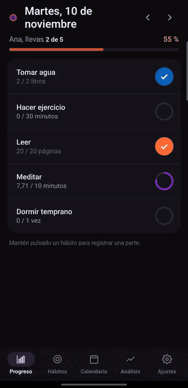
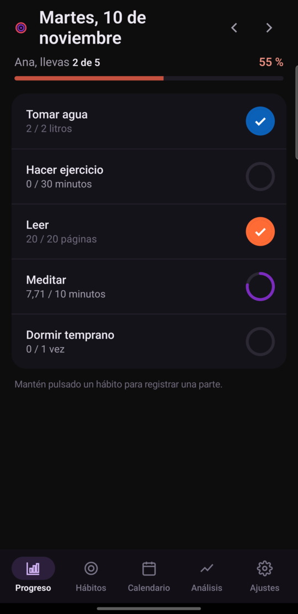
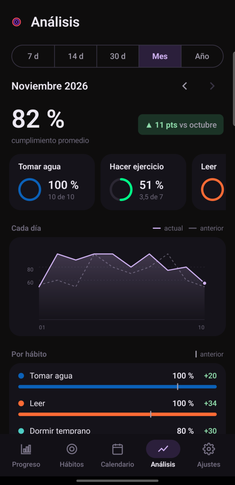
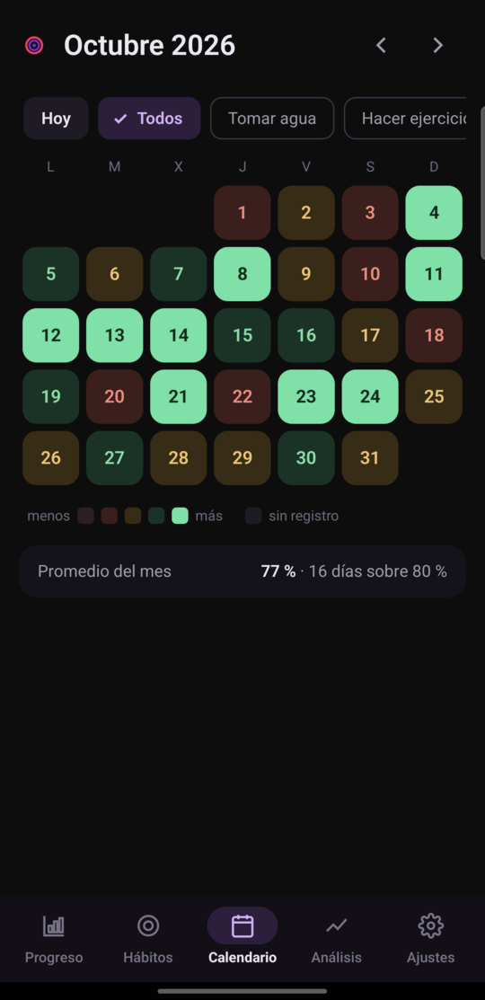
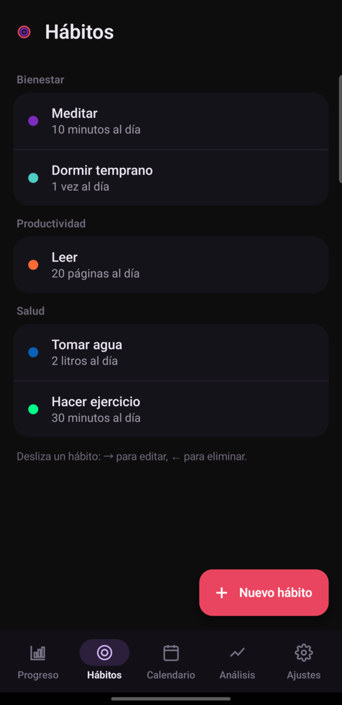
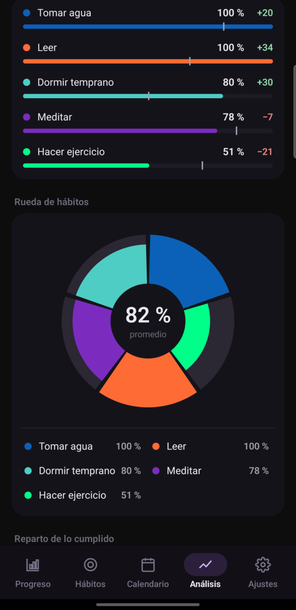
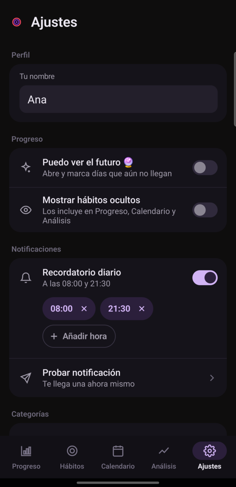
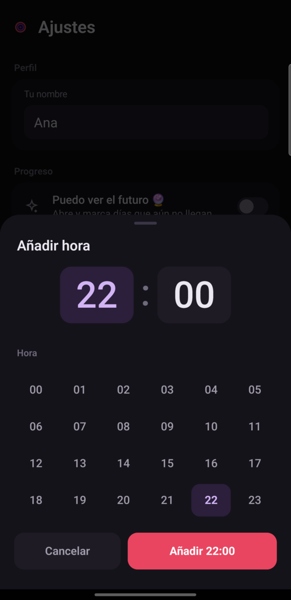
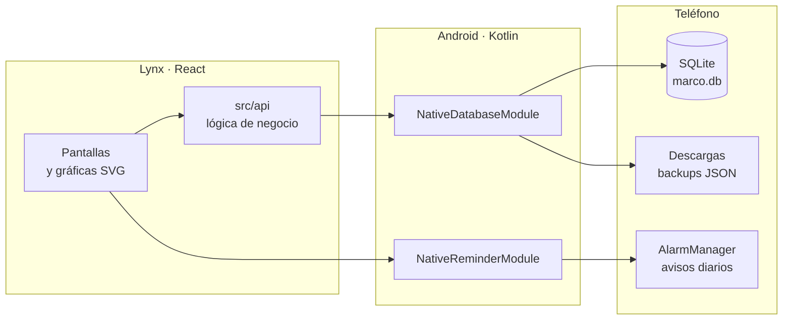

<div align="center">

<picture>
  <source media="(prefers-color-scheme: dark)" srcset="branding/marco-lockup.svg">
  
</picture>

**Tus hábitos de cada día, en el teléfono y en ningún otro sitio.**<br>
Márcalos con un toque, mira cómo vas y recibe un aviso a la hora que elijas. Sin cuenta, sin servidor y sin conexión.

[](LICENSE)
[](https://github.com/jorge07RD/marco-native/releases/latest)




<sub>Capturas y GIF hechos con datos de ejemplo, generados con <code>scripts/datos-demo.py</code>.</sub>

</div>

## Por qué existe

Casi todas las apps de hábitos piden una cuenta, sincronizan con un servidor y acaban empujando a una suscripción. Para apuntar si hoy tomaste agua o leíste veinte páginas no hace falta nada de eso. **Marco guarda todo en una base SQLite dentro del teléfono**, funciona sin conexión desde el primer arranque y está pensada para usarse de noche, repasando el día con poca luz.

## Capturas

<table>
  <tr>
    <td width="50%"></td>
    <td width="50%"></td>
  </tr>
  <tr>
    <td align="center"><b>Progreso.</b> Un toque marca el hábito; dejarlo pulsado registra una parte (7,71 de 10).</td>
    <td align="center"><b>Análisis.</b> El mes contra el anterior, cada día y cada hábito.</td>
  </tr>
  <tr>
    <td></td>
    <td></td>
  </tr>
  <tr>
    <td align="center"><b>Calendario.</b> Cada día con el color del semáforo: rojo, ámbar, verde y menta si se completó.</td>
    <td align="center"><b>Hábitos.</b> Agrupados por categoría, cada uno con su color y su meta.</td>
  </tr>
</table>

<p align="center">
  
  
  
</p>

## Qué puedes hacer

| | Función | Detalle |
|---|---|---|
| **Progreso** | Marcar el día | Un toque completa el hábito. Dejarlo pulsado abre el registro parcial (15 de 20 páginas), y el anillo se llena en proporción |
| **Hábitos** | Crear y editar | Categoría, unidad, meta diaria, días de la semana y un color libre. Se borran deslizando la fila; también se pueden ocultar |
| **Calendario** | Ver el mes | Cada día pintado según su cumplimiento, con filtro por hábito. Tocar un día abre su Progreso |
| **Análisis** | Entender cómo vas | 7, 14 o 30 días, un mes o un año. Comparación con el periodo anterior, línea diaria, ranking y seis gráficas más, todas ampliables |
| **Recordatorios** | Avisos a tu hora | Una o varias horas al día, elegidas con un selector propio. Sobreviven a un reinicio del teléfono |
| **Backups** | Copias en Descargas | Exporta toda la base a un JSON y restáurala cuando quieras |
| **Logro** | Día completo | Una animación cuando terminas todos los hábitos del día |

Al crear el perfil aparecen cinco hábitos de ejemplo (`src/api/semilla.ts`) para que ninguna pantalla arranque vacía. Se borran como cualquier otro.

## Cómo funciona



La interfaz está escrita en **React sobre [Lynx](https://lynxjs.org/)** y va empaquetada en un shell nativo de Android con [Sparkling](https://tiktok.github.io/sparkling/), así que se instala como cualquier app, sin LynxExplorer. Toda la lógica vive en TypeScript (`src/api/`). Kotlin solo se encarga de lo que exige Android: ejecutar las consultas SQLite, programar las alarmas y escribir en Descargas.

## Descargar

Descarga la última versión desde [Releases](https://github.com/jorge07RD/marco-native/releases/latest):

| Plataforma | Archivo | Cómo instalar |
|---|---|---|
| **Android** | `marco-*.apk` | Ábrelo en el teléfono. Android pedirá permitir la instalación desde el navegador o el gestor de archivos |

Cada release incluye el SHA-256 del APK en sus notas.

> [!NOTE]
> Si compilaste tú la app antes, quedó firmada con otra clave y Android no deja instalar el release encima. Exporta un backup desde Ajustes, desinstala, instala el APK y restaura el backup.

## Requisitos

| | Necesitas |
|---|---|
| **Teléfono** | Android 7.0 o superior (arm64 o armv7). Probado en un Samsung Galaxy S23 Ultra |
| **Para compilar** | Node 22 o 24, Android SDK con la plataforma 34 y **JDK 17** |

## Compilar desde el código

```bash
npm install
npm run run:android
```

Compila el bundle de Lynx, lo empaqueta como assets de Android, compila el APK de debug y lo instala y lanza en el teléfono conectado por USB (`adb devices` debe listarlo).

> [!WARNING]
> El compilador de Kotlin del proyecto no entiende un JDK 21 o más nuevo y falla con un `IllegalArgumentException` que solo dice el número de versión. Si tu JDK por defecto es más nuevo, apunta a uno 17 solo para este comando:
>
> ```bash
> JAVA_HOME=/usr/lib/jvm/java-17-openjdk npm run run:android
> ```

Si el build termina pero la instalación falla porque el teléfono se desconectó, reconéctalo y corre:

```bash
adb install -r android/app/build/outputs/apk/debug/app-debug.apk
```

Otros comandos:

```bash
npm run build   # solo el bundle de Lynx (dist/) y su copia a los assets nativos
npm run test    # vitest
```

### APK de release firmado

El keystore y sus contraseñas nunca van al repo. Gradle los lee de un `keystore.properties` fuera del proyecto, en `~/.config/marco-native/keystore.properties` o en la ruta de la variable `MARCO_KEYSTORE_PROPERTIES`:

```properties
storeFile=/ruta/a/marco-release.jks
storePassword=...
keyAlias=marco
keyPassword=...
```

```bash
npm run build
cd android && ./gradlew assembleRelease
```

El APK queda en `android/app/build/outputs/apk/release/app-release.apk`. Sin el archivo, el release sale sin firmar.

### Capturas con datos de ejemplo

```bash
./scripts/app-demo.sh
```

Instala una copia aparte de la app (`com.example.sparkling.go.demo`) con el perfil «Ana», los cinco hábitos de ejemplo y siete semanas de historial inventado. Convive con la app normal y no toca sus datos.

## Privacidad

- **Tus datos no salen del teléfono.** No hay cuenta, servidor ni analítica, y el código de Marco no hace ninguna petición de red. El permiso de Internet lo declara el shell de Sparkling.
- Los backups son JSON **sin cifrar** en la carpeta de Descargas: cualquiera con acceso a tus archivos puede leerlos.
- Desinstalar la app borra la base. Si quieres conservar tu historial, exporta antes un backup.

## Límites

- **Solo Android.** La carpeta `ios/` es la del scaffold de Sparkling y no está configurada.
- El paquete sigue siendo el del scaffold (`com.example.sparkling.go`).
- Si no concedes el permiso de alarmas exactas, Android puede retrasar los recordatorios.
- Probada por ahora en un solo modelo de teléfono. Los informes de otros dispositivos son bienvenidos.

## Estructura

```text
src/
  pages/main/     entrada de Sparkling: onboarding o la app según haya perfil
  screens/        Progreso, Hábitos, Calendario, Análisis y Ajustes
  api/            lógica de negocio contra SQLite, un archivo por área
  charts/         gráficas SVG hechas a mano (Lynx no tiene librería de charts)
  components/     piezas compartidas: barra de pestañas, selector de hora, íconos
  lib/            utilidades puras: fechas, periodos, escala de progreso, formato
  db/             puente hacia SQLite y backups
android/app/src/main/java/com/example/sparkling/go/
  MarcoDbHelper.kt         esquema SQLite
  NativeDatabaseModule.kt  ejecuta las consultas
  ReminderScheduler.kt     alarmas diarias (una por hora elegida)
  LynxInputComponent.kt    componente <input> propio
branding/         logotipo
scripts/          datos de ejemplo, app demo y lockup
```

El contexto del producto y sus decisiones de diseño están en [`PRODUCT.md`](PRODUCT.md).

## Notas técnicas

Cosas que costó descubrir en el dispositivo y que no se deducen leyendo el código. Cada una está explicada en su archivo; esto es solo el índice.

- **Los módulos nativos hay que registrarlos** en `SparklingApplication.kt` con `addLynxModules(...)`. Escribir la clase no basta para que exista `NativeModules.<Nombre>` en JS.
- **`<svg>` no es parte del core de Lynx**: es un X-Element aparte (`org.lynxsdk.lynx:xelement-svg`), forzado a `3.7.0` y registrado a mano. Su renderer ignora `<line>` y no resuelve `var()`, así que las gráficas usan `<path>` y colores literales (`src/charts/paleta.ts`).
- **Sin code splitting.** Un import lazy se compila como un bundle Lynx aparte que no hereda el CSS global. Ver `src/router.tsx`.
- **El CSS es global entre archivos**: los nombres de clase tienen que ser únicos en toda la app.
- **El hilo principal (`'main thread'`) no ve las estructuras de módulo**, solo los números (`DashboardScreen.tsx`).
- **`touchstart` llega tarde y `touchend` a veces no llega** dentro de un `scroll-view` o con un modal encima (`DashboardScreen.tsx`, `SwipeRow.tsx`).
- **Sin `Intl`**: PrimJS no lo garantiza, así que fechas y números se formatean a mano (`src/lib/date.ts`, `src/lib/formato.ts`).

## Contribuir

Los issues y pull requests son bienvenidos. Todo cambio a `master` entra por pull request y necesita la revisión del mantenedor. Antes de abrir uno, comprueba que `npm run test` pasa y que el cambio se ve bien en un teléfono real.

## Licencia

[MIT](LICENSE).
